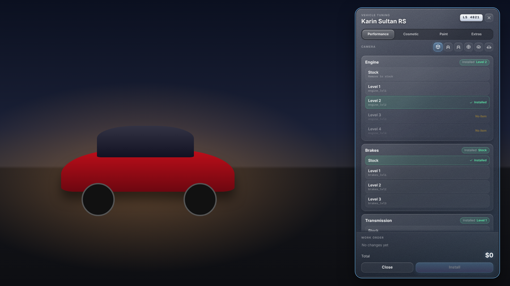
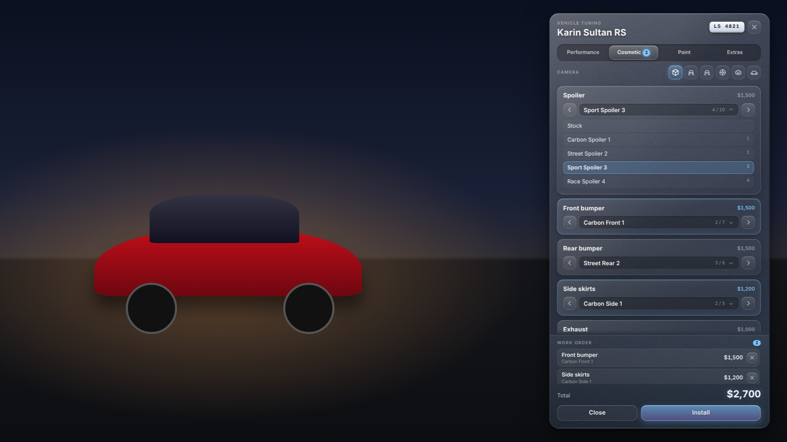
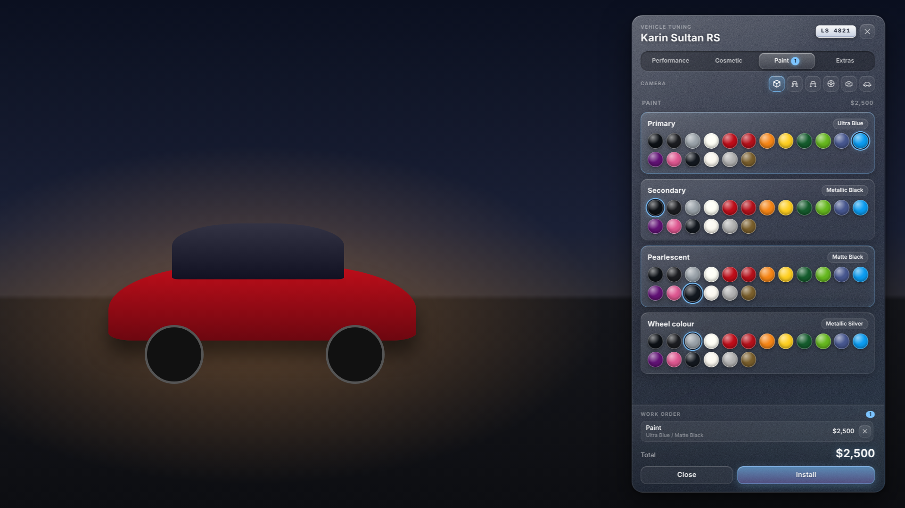
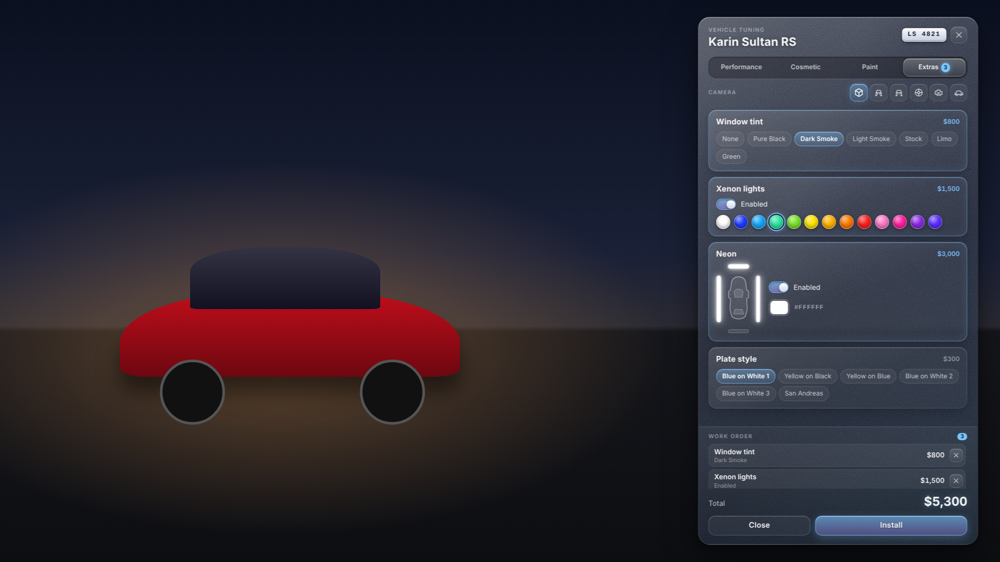
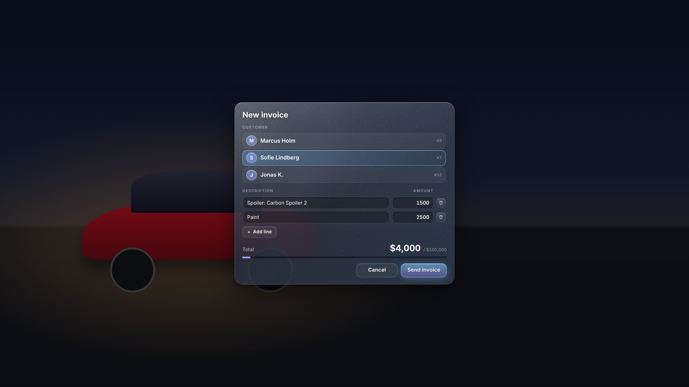
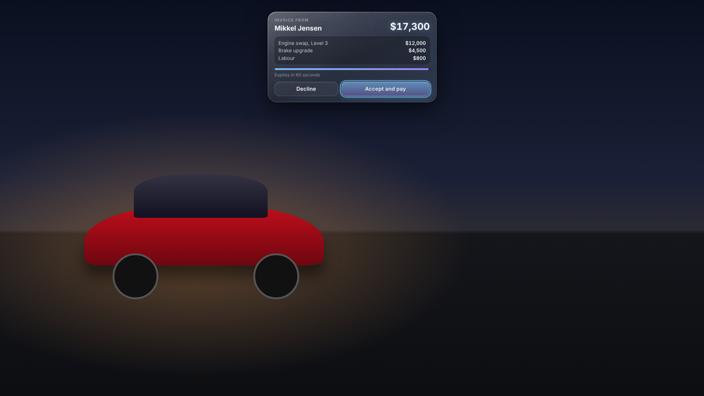

# ap1le_mechanicjob

A mechanic job for ESX Legacy. Mechanics repair vehicles, swap performance parts, apply cosmetic
tuning in a glassmorphism tuning menu, tow vehicles on a flatbed and bill customers with invoices.

## Features

- **Repairs**: full engine and body repairs and tyre changes in a workshop, and a quick engine
  field repair that works anywhere (repair kit, capped at a configurable engine health).
- **Performance swaps**: engine, brakes, transmission, suspension, armour and turbo, in levels.
  Each swap is two physical steps: the old part is taken out, then the new part is put in.
  Swapped-out parts go back into the mechanic's inventory.
- **Cosmetic tuning**: spoilers, bumpers, skirts, exhaust, wheels, paint, window tint, xenon,
  neon, plate style and more, in a right-side tuning panel where the car stays visible.
- **Towing**: load a vehicle onto a flatbed and unload it at a drop point.
- **Invoices**: a mechanic sends an itemised invoice to a nearby player, who accepts or declines
  it. The payment is split between the mechanic's society and the mechanic who sent it.
- **Workshops**: work with full repairs, performance swaps and cosmetic tuning only happens
  inside a configured workshop. Blips are shown on the map.

## Dependencies

| Resource | Purpose |
|---|---|
| `oxmysql` | Database access |
| `ox_lib` | Callbacks, notifications, locales, points, context menus |
| `es_extended` | ESX Legacy core (jobs, players, accounts) |
| `ox_inventory` | Items for repair kits and performance parts |
| `ox_target` | Vehicle interaction options |
| `esx_addonaccount` | Shared society account for mechanic income |

## Installation

1. **Database.** Run `sql/install.sql` once on the server database. It creates the `mechanic` job,
   its four grades (recruit, mechanic, experienced, boss), the `society_mechanic` account and the
   `ap1le_mechanicjob_parts` table (a server-only record of the parts this resource installed).
   The script can be run again safely. It does not change `owned_vehicles`.
2. **Items.** Open `install/items.lua` and paste its entries into the main table of
   `ox_inventory/data/items.lua`. Add one PNG per item to `ox_inventory/web/images/<name>.png`.
3. **Resource.** Copy the `ap1le_mechanicjob` folder into your `resources` directory.
4. **server.cfg.** Start the resources in this order:

   ```
   ensure oxmysql
   ensure ox_lib
   ensure es_extended
   ensure ox_inventory
   ensure ox_target
   ensure esx_addonaccount
   ensure ap1le_mechanicjob
   ```

5. **Give the job.** Assign the `mechanic` job to a player with the ESX job tools, and pick a grade.
   All grades can use every feature. Only the grade label differs.

## Configuration

Everything is set in `config.lua`. The main settings:

- `Config.Job`: job name that can use the resource (`mechanic`).
- `Config.Workshops`: list of workshops. Each has a `coords`, a `radius` and a blip. Full
  repairs, swaps and tuning need the mechanic to be inside one of these spheres.
- `Config.MaxVehicleDistance`: how close the mechanic must be to the vehicle.
- `Config.Repair`: item, time and workshop requirement for each repair. `field` also sets
  `maxEngineHealth`.
- `Config.Performance`: for each part, the item names for each level, the removal and install
  times, and the GTA mod type.
- `Config.Cosmetic`: which cosmetic mods are available, their prices and the animation used.
- `Config.Colours`: paint palette shown in the tuning menu.
- `Config.Invoice`: society account, society share, maximum lines and total, expiry time,
  distance and cooldown.
- `Config.Towing`: flatbed model, attach and unload offsets, and load distance.
- `Config.MinTimeFactor`: the server rejects a finish that comes too early. The default is 0.8
  of the expected time.

Change item names only if you also change them in `install/items.lua`.

## How swaps work

A performance swap runs in two steps, and each step is a real animation with props:

1. **Remove.** The old part is taken out of the car. For example, for an engine the mechanic opens
   the hood, brings in the hoist, unbolts the engine and lifts the old block out. The old part
   is returned to the mechanic's inventory.
2. **Install.** The new part is brought in, lifted into place, bolted down and the hood is closed.

The new part is removed from the inventory when the install step finishes. Stock (level 0) has
no item. Turbo is a single on/off part. Length of each step comes from `removeTime` and
`installTime` in `Config.Performance`. The server checks the time and the items, not the client.

A removed part is only returned when this resource installed that exact level (recorded in
`ap1le_mechanicjob_parts`). Parts fitted elsewhere, for example bought at a cash tuning shop or
present before this resource was installed, can still be swapped out, but no item is returned.
If the old part no longer fits in the mechanic's inventory after the swap, it is dropped on the
ground next to them.

Swaps and cosmetic saves on an owned vehicle need the owner to be present: the mechanic must
own the vehicle, or the owner must be online and within 30 m of it. The vehicle model must also
match the stored model.

## How invoices split

When a customer accepts an invoice:

- The customer pays `Config.Invoice.account` (bank by default). The payment must cover the total.
- `Config.Invoice.societyShare` (default 70 percent) goes to the `society_mechanic` account.
- The rest (default 30 percent) goes to the bank account of the mechanic who sent the invoice.

Both sides receive a notification. An invoice expires after `expireSeconds` if the customer does
not respond. The totals and prices are checked by the server, and the client cannot change them.

## Security notes

- The server checks the job, distance, workshop, items, money and timing on every action. The
  client only sends IDs and choices.
- Item names, prices, amounts and timings come from `config.lua` on the server, never from the
  client.
- Plates are compared trimmed, and tuning can only be saved for vehicles in `owned_vehicles`.
  Because the client controls a vehicle's plate, the server also checks the stored model and
  that the owner is present before any swap or save.
- Cosmetic values are range-checked per key (mod indexes, colours, tint, plate style, neon,
  xenon) before they are saved.
- Cosmetic saves only write the cosmetic keys, so performance levels cannot be changed through
  the tuning menu.
- Repeatable actions are rate-limited, and suspicious calls are logged with the prefix
  `[ap1le_mechanicjob] suspicious:`.
- ox_target `groups` is convenience only. The server re-checks the job on every call.

## Glassmorphism UI note

The tuning menu and the invoice popup are NUI pages. FiveM draws the NUI as a transparent layer
over the game, so `backdrop-filter` only blurs HTML behind the element, not the game world. The
glass look comes from translucent layered gradients, a thin light border, an inner highlight, a
soft shadow and a subtle noise texture. `backdrop-filter` is used between stacked HTML layers.
The tuning panel sits on the right so the car stays visible. The invoice popup is compact and
centred at the top.

## Test checklist

Test with a mechanic and a customer, both with the mechanic job assigned, on a server with the
dependencies above installed.

- [ ] Start the server with no errors in the console. Locales load (`en` and `da`).
- [ ] A non-mechanic gets no mechanic options on vehicles and cannot start an action.
- [ ] Workshop blips show on the map.
- [ ] Engine repair in a workshop takes the kit, runs the animation and repairs the engine.
- [ ] Engine repair outside a workshop is refused. Field repair works anywhere with a repair kit.
- [ ] Body repair and tyre change work only in a workshop.
- [ ] Engine swap: the old engine comes out (lifted out with the hoist), the new one goes in, and
      the old part is in the mechanic's inventory.
- [ ] Cancelling a swap mid-way (~INPUT_FRONTEND_CANCEL~) restores the old part visually and
      keeps the items unchanged.
- [ ] Each swap category works (brakes, transmission, suspension, armour, turbo) and the
      level saved on an owned vehicle is applied after a restart.
- [ ] Swapping to stock returns the part to the inventory (only for parts installed by this
      resource; a part fitted elsewhere is removed without returning an item).
- [ ] A swap or cosmetic save on someone else's car is refused when the owner is offline or
      more than 30 m away.
- [ ] Cosmetic changes preview live, are saved for owned vehicles, and are billed through an
      invoice.
- [ ] Unowned vehicles get the cosmetic preview, show the "not saved" message and are not saved.
- [ ] Load a car onto the flatbed, drive the truck, and unload the car at the drop point.
- [ ] Send an invoice to a nearby player. Accept it: the customer is charged, the society
      account gets 70 percent and the mechanic's bank gets 30 percent. Both notifications show
      the amounts as money (for example `$17,300`).
- [ ] Decline an invoice, and let one expire. Both sides get notified.
- [ ] Sending an invoice too far away, with too many lines, or with a total above the maximum is
      refused.
- [ ] Escape closes the tuning menu and the invoice creation form. The customer invoice popup
      stays until accepted or declined.
- [ ] The NUI layout works at narrow widths with no horizontal scroll.
- [ ] Restart the resource: no leftover props, cameras, scaleforms or NUI focus.

## Screenshots

Rendered in Chromium with demo data (the car is a placeholder background, not the game).

| Performance | Cosmetic |
|---|---|
|  |  |
| **Paint** | **Extras** |
|  |  |
| **Create invoice** | **Customer invoice** |
|  |  |
