# ap1le_mechanicjob

Mekanikerjob til ESX Legacy. Mekanikerne reparerer køretøjer, skifter performance-dele fra værkstedets lager,
tuner udseendet i et kamera-styret tuning-panel, bugserer biler på en flatbed, sender fakturaer og bestiller
dele, som ikke er på lager. Chefen har en fysisk computer på værkstedet til lager, bestillinger, personale og økonomi.

## Funktioner

- **Reparationer**: fuld motor- og karosserireparation og dækskift i et værksted. Motorreparation på stedet
  virker overalt med et reparationssæt, dog kun op til en konfigurerbar motorstatus.
- **Performance-skift**: motor, bremser, gearkasse, undervogn, panser og turbo, i niveauer. Hvert skift er to
  fysiske trin med animation: den gamle del tages ud, og den nye monteres. Dele tages fra og lægges tilbage i
  værkstedets lager (stash), ikke i mekanikerens egen taske.
- **Cosmetic tuning**: alle GTA-muligheder for køretøjet, grupperet i kategorier og underkategorier. Man kan
  bevæge kameraet rundt om bilen med musen (træk for at dreje, rul for at zoome) eller bruge kamerapresets.
  Lakering har alle GTA-farver, grupperet i metallic, matte, metal, chrome, perlemor og worn/util. Kamæleon-farverne
  kræver en ekstra fil (se afsnittet "Kamæleon-farver").
- **Lager og bestilling**: hvert værksted har et lager. Dele, som ikke er på lager, kan bestilles fra tuning-menuen
  eller fra computeren. Virksomheden betaler, og leverancen kommer som en kasse ved leveringspunktet.
- **Chefens computer**: en fysisk computer på hvert værksted med et macOS-lignende UI (skrivebord, menulinje med
  ur, dock og programvinduer). Se afsnittet om computeren.
- **Bugsering**: læs et køretøj op på en flatbed og aflæs det på et afleveringssted.
- **Fakturaer**: en mekaniker sender en faktura med linjer til en spiller i nærheden, som accepterer eller afviser den.
  Beløbet deles mellem virksomhedens konto og den mekaniker, der sendte fakturaen.
- **Værksteder**: fuld reparation, performance-skift, tuning og bestillinger virker kun i et konfigureret værksted
  (undtagen motorreparation på stedet og computerens programmer, der også virker ved computeren).
- **Manuelt skift**: som alternativ til den automatiske animation kan hvert performance-skift gøres trin for trin
  af mekanikeren selv (værktøj, motorløft, bolte og løft med tastaturet). Se afsnittet om manuelt skift.
- **Bilvask**: en mekaniker kan rense en bil med et rengøringssæt. Vaskningen faktureres bagefter.
- **Presets og kundeopgaver**: faste og egne presets til tuning, og en kunde kan designe sin bil ved et
  kundeterminal. Designet sendes til mekanikerne som en kundeopgave på bilen.
- **Indlæs sidste**: tuning husker den kurv, du lukkede uden at montere, pr. køretøj, så du kan fortsætte senere.

## Afhængigheder

| Resource | Formål |
|---|---|
| `ap1le_core` | Notifikationer, menuer, dialoger, progress-bjælke og hjælpetekst (UI-laget i hele resourcen) |
| `es_extended` | ESX Legacy-kernen (job, spillere, konti) |
| `ox_lib` | Callbacks, locales og hjælpefunktioner |
| `oxmysql` | Databaseadgang |
| `ox_inventory` | Varer, lagre (stashes) og kasser |
| `ox_target` | Interaktion med køretøjer, lagre, kasser og computeren |
| `esx_addonaccount` | Virksomhedskonto (`society_mechanic`) |
| `esx_society` | Registrerer firmaet, så ESX' egne boss-menuer kender det (kræver esx_society 1.15.0 eller nyere, se Sikkerhed) |

## Installation

1. **Database.** Kør `sql/install.sql` én gang på serverens database. Scriptet opretter jobbet `mechanic` med
   fire grader (0 recruit, 1 mechanic, 2 experienced, 3 boss), virksomhedskontoen `society_mechanic` og disse
   tabeller:
   - `ap1le_mechanicjob_parts`: hvilke performance-dele scriptet har monteret (server-side).
   - `ap1le_mechanicjob_orders`: bestillinger og leverancer, pr. værksted.
   - `ap1le_mechanicjob_invoices`: betalte fakturaer.
   - `ap1le_mechanicjob_transactions`: indsættelser, hævninger, bestillinger og fakturaer til økonomien.
   - `ap1le_mechanicjob_prices`: prisliste for cosmetic-dele, som overskriver priserne i `config.lua`.
   - `ap1le_mechanicjob_presets`: gemte presets (pr. spiller og bilmodel).
   - `ap1le_mechanicjob_workorders`: kundeopgaver fra kundeterminalen (pr. nummerplade).

   Scriptet kan køres igen uden problemer: eksisterende grader (også nogen, du har omdøbt eller ændret løn på)
   bliver ikke rørt. Det ændrer ikke `owned_vehicles`.

   **Genstart serveren bagefter.** ESX læser jobs og grader, og esx_addonaccount læser virksomhedskonti, kun når
   de starter. Genstart derfor serveren, eller mindst `restart esx_addonaccount` og derefter
   `restart esx_society`. Indtil da virker ansættelse/forfremmelse, bestillinger og chefens indsæt/hæv ikke
   (kontoen findes ikke endnu).
2. **Items.** Åbn `install/items.lua` og indsæt alle elementerne i hovedtabellen i `ox_inventory/data/items.lua`.
   Læg et PNG-billede pr. vare i `ox_inventory/web/images/<navn>.png`, fx `engine_lvl1.png`. Genstart derefter
   `ox_inventory`. Filen indeholder alle reparationssæt, rengøringssættet til bilvask, performance-dele på alle niveauer og turbo.
3. **Resource.** Kopiér mappen `ap1le_mechanicjob` til din `resources`-mappe.
4. **server.cfg.** Start resources i denne rækkefølge (ap1le_core skal være før dette script):

   ```
   ensure oxmysql
   ensure ox_lib
   ensure es_extended
   ensure ox_inventory
   ensure ox_target
   ensure esx_addonaccount
   ensure esx_society
   ensure ap1le_core
   ensure ap1le_mechanicjob
   ```

   Tilføj også `setr ox:locale da` i `server.cfg`, ellers bruges de engelske tekster.

5. **Giv jobbet.** Tildel jobbet `mechanic` til en spiller med ESX's jobværktøjer og vælg en grad. Alle grader
   kan bruge alle funktioner undtagen chefens programmer, som kræver grad `Config.BossGrade` (3) eller højere.
   Kører du allerede esx_mechanicjob's grader (0-4, hvor 4 er `boss`), så sæt `Config.BossGrade = 4`.

## Konfiguration

Alt indstilles i `config.lua`. Vigtigste punkter:

- **Værksteder (`Config.Workshops`)**. Hvert værksted har en `id`, en `label`, `coords` og `radius` (sfæren hvor
  fuld reparation, skift og tuning virker), en blip og tre punkter:
  - `stash`: værkstedets lager. Lageret er et ox_inventory-stash med id `ap1le_mechanicjob_<id>`, og det oprettes
    automatisk ved start. `slots` og `weight` sætter størrelsen.
  - `computer`: computerens position og retning (`w`). `spawnProp = true` spawner en bærbar computer med
    `prop_laptop_01a` på pladsen.
  - `delivery`: hvor leverede kasser står, klar til afhentning.
  - `terminal`: kundens designterminal (valgfri). Kunden står ved terminalen med sin bil i nærheden.
- **`Config.BossGrade`**: den mindste jobgrad, der er "chef" (standard `3`). Chefen bruger personale, økonomi og
  prisliste på computeren. Serveren tjekker grad ved hvert kald.
- **`Config.Repair`**, **`Config.Performance`**: dele, tider og niveauer for reparationer og skift.
- **`Config.Shop`**: leveringstid (`deliveryMinutes`), oppakningstid (`unpackTime`), højeste antal pr. vare og
  pr. ordre (`maxPerLine`, `maxLines`), højeste antal åbne ordrer pr. værksted (`maxOpenOrders`), og prisen pr.
  vare i `items`.
- **`Config.Cosmetic`**: grupper, underkategorier, mods og ekstra valg, med standardpris og animation for hver.
  `maxPrice` er den højeste pris, chefen kan sætte i prislisten.
- **`Config.Invoice`**: virksomhedskonto, andel til virksomheden (`societyShare`), største antal linjer og samlet
  beløb, udløbstid, afstand og ventetid.
- **`Config.Computer`**: afstande til computeren, højeste overførselsbeløb, antal historikrækker og chefens konto
  (`account`, standard `bank`), som indsæt og hæv flytter penge til og fra.
- **`Config.ManualSwap`**: slå manuelt skift til (`enabled`) og den mindste tidsandel (`minTimeFactor`).
- **`Config.Wash`**: vare (`item`), tid, pris og om vask kun må ske i et værksted (`workshopOnly`).
- **`Config.Presets`**: højeste antal egne presets, længde på navne, hvor længe en kundeopgave gælder
  (`workOrderHours`) og de faste presets (`builtin`).
- **`Config.Towing`**: flatbed-model og forskydninger.

Ændr kun varenavne, hvis du også ændrer dem i `install/items.lua`.

## Manuelt skift

Med `Config.ManualSwap.enabled = true` laver mekanikeren hvert performance-skift selv i stedet for den automatiske
animation. Skiftet følger disse trin:

1. Gå hen til værktøjskassen og tag den (E ved target).
2. Tag fat i motorløftet og skub det hen til bilen. Løftet flytter sig med spilleren.
3. Gå til hvert markerede bolt-punkt på bilen og tryk E. Løsn boltene; det er et timet trin med en bar.
4. Hold løftet og løft delen ud med W/S. Læg den ned.
5. Tag den nye del, sæt den på plads med W/S og spænd boltene. Det sidste trin er at sætte værktøjet tilbage.

Den aktuelle instruktion vises med en hjælpetekst. Man kan stoppe når som helst med Backspace (tasten kan ændres
under tastaturindstillinger). Går man for langt væk fra bilen, stoppes arbejdet. Serveren bruger samme
`perf:begin`/`perf:finish` som ved det automatiske skift, men med `Config.ManualSwap.minTimeFactor` i stedet for
`Config.MinTimeFactor`. Dele tages og lægges tilbage i værkstedets lager, ligesom før.

## Bilvask

Mekanikere kan vaske en bil via target-menuen "Rens bil". Det kræver en `cleaning_kit` i mekanikerens egen taske,
og der bruges ét sæt, når vaskningen er færdig. `Config.Wash.workshopOnly = false` betyder, at vask virker overalt;
sæt den til `true`, hvis den kun må ske i et værksted. Under vaskningen går smudset ned, og bilen er ren til sidst.
Derefter åbnes fakturadialogen med linjen "Rens bil" og prisen fra prislisten (id `wash`, standard
`Config.Wash.price`). Serveren tjekker tid og afstand, og klienten kan ikke ændre prisen.

## Presets og kundeopgaver

En preset er en gemt tuning af én bil. Presets kan bruges i tuning-menuen, og et preset kan gemmes og slettes igen:

- **Faste presets** (`Config.Presets.builtin`) virker på alle modeller. Standardpresetet "Maks performance" sætter
  alle performance-kategorier til det højeste niveau og ændrer ikke kosmetik.
- **Egne presets** gælder kun for den model, de er gemt på. Man kan have op til `Config.Presets.maxPerPlayer`, og
  navnet må være 1-32 tegn (`maxNameLength`). Man kan kun slette sine egne.

Et preset lægges i kurven. Kosmetiske værdier, som findes på den bil, vises med det samme. Performance-niveauer
bliver til ventende skift i kurven, som udføres ét efter ét med det normale skiftforløb, og hvert skift kræver
en del på lager.

**Kundens terminal.** Ved `terminal` i et værksted kan alle spillere bruge designterminalen, når de står ved den
(inden for 3 m på serveren) og har en ejet bil inden for `Config.MaxVehicleDistance`. Designet åbner tuning-panelet i
designtilstand: kunden kan kun prøve ændringer på sin bil. Der kan ikke monteres, skiftes, bestilles eller købes,
og priserne er kun estimater. Performance vises som ønsket niveau. Kunden kan gemme sit design som eget preset, og
"Send til mekaniker" gemmer designet som en kundeopgave på bilens nummerplade. Opgaven udløber efter
`Config.Presets.workOrderHours` timer.

Når en mekaniker åbner tuning på en bil med en kundeopgave, vises banneret "Kundens ønske" med knappen "Indlæs".

**Indlæs sidste.** Lukkes tuning uden at montere, og kurven ikke var tom, gemmer klienten kurven pr. nummerplade
(de seneste 20 køretøjer). Næste gang tuning åbnes på samme bil, vises banneret "Indlæs sidste" med antal ændringer.
"Indlæs" lægger kurven tilbage med forhåndsvisning.

## Lager og bestillinger

Hvert værksted har sit eget lager. Performance-skift tager den nye del fra lageret og lægger den gamle tilbage.
Hvis den nye del ikke er på lageret, kan du se det i tuning-menuen (knappen "Bestil" ved niveauer uden lager) og
bestille den der, eller bestille den fra computerens program "Bestil".

En bestilling fungerer sådan:

1. Mekanikeren vælger varer og antal. Serveren tjekker varerne mod `Config.Shop.items`, antal og linjer, og at
   værkstedet ikke har for mange åbne ordrer. Prisen tages fra konfigurationen, ikke fra spilleren.
   Mekanikere under chef-graden kan kun bestille små ordrer: 1 slags vare, højst 2 stk., højst $30.000 pr. ordre
   og højst 2 åbne ordrer ad gangen (`Config.Shop.staffLimits` i `config.lua`). Chefen har de fulde
   grænser fra `Config.Shop`.
2. Virksomhedskontoen betaler summen. Hvis den ikke har penge nok, bliver bestillingen afvist.
3. Ordren står som "på vej" i `Config.Shop.deliveryMinutes`. I den tid ser alle mekanikere ordrerne i
   computerens "Ordrer"-program og i F6-menuen under "Åbne bestillinger".
4. Når tiden er gået, står en kasse ved værkstedets leveringspunkt. Alle mekanikere får besked om det.
5. En mekaniker går hen til kassen og vælger "Pak kassen ud". Kassen åbnes med animation og bar, og varerne
   lægges i værkstedets lager. Hvis lageret er fuldt, bliver kassen stående, og der kommer en besked.

Ordrer gemmes i databasen, så de overlever en genstart af serveren.

## Computeren

Computeren er en fysisk bærbar på værkstedet. Man bruger den med target-menuen "Brug computeren". Den har et
macOS-lignende UI med skrivebord, menulinje (med ur og værkstedets navn), dock og vinduer, som kan flyttes,
minimeres og lukkes. Det røde trafiklys lukker et vindue. Esc eller "Luk computer" i menuen lukker computeren.

| Program | Hvem | Hvad |
|---|---|---|
| **Lager** | Alle mekanikere | Varer i værkstedets lager med antal og status (på lager, lav beholdning, ikke på lager). Søg og filtrér efter kategori. |
| **Bestil** | Alle mekanikere | Katalog med varer, kurv, antal og total. "Virksomheden betaler". "Bestil" sender ordren. |
| **Ordrer** | Alle mekanikere | Åbne og afhentede ordrer med en nedtælling til leveringen. |
| **Personale** | Chef | Ansatte med online-status og stilling. Ansæt nærliggende spillere, skift stilling eller fyr. |
| **Økonomi** | Chef | Virksomhedens saldo, indsæt og hæv mellem chefens bankkonto og firmakontoen, og historik over fakturaer, ordrer og overførsler. |
| **Prisliste** | Chef | Overskriv priser på cosmetic-dele. Ændringer gemmes først, når du trykker "Gem priser". |

Regler for chefen:

- Personale: man kan kun ansætte spillere, der står inden for `Config.Computer.hireDistance` fra computeren og
  ikke allerede er mekanikere. Spilleren får et jobtilbud på sin egen skærm og skal selv sige ja (tilbuddet lukker
  efter 30 sekunder); først derefter skifter jobbet. Man kan kun ændre og fyre ansatte med en lavere stilling end sin egen, og aldrig sig selv.
  Ansatte, der er offline, kan også ændres.
- Økonomi: serveren flytter selv pengene mellem chefens bankkonto og virksomhedskontoen med ESX' standardfunktioner
  (`addAccountMoney`/`removeAccountMoney` og `esx_addonaccount:getSharedAccount`), efter at have tjekket chef-grad,
  afstand til computeren og beløb. Beløbet er et helt tal fra 1 til `maxTransfer`.
- Prisliste: hver pris skal være et helt tal fra 0 til `Config.Cosmetic.maxPrice`. Priserne gemmes i databasen
  og overskriver standardpriserne i `config.lua`.

Alle kald til computeren tjekker, at spilleren er inden for `Config.Computer.serverDistance` fra computeren på
serveren. Det er ikke nok, at klienten siger det.

## Fakturaer

- Mekanikeren åbner "Send faktura" fra F6-menuen. Dialogen viser de nærmeste spillere og en linje pr. prisregel,
  med standardprisen udfyldt. Der kan tilføjes én ekstra linje. Linjer med 0 udelades.
- Kunden får en bekræftelse med linjer, samlet beløb og en nedtælling. Svarer kunden ikke i tide, udløber fakturaen.
- Når kunden betaler, går `Config.Invoice.societyShare` (standard 70 %) til virksomhedskontoen. Resten går til
  mekanikerens bankkonto. Begge får besked. Betalte fakturaer gemmes i `ap1le_mechanicjob_invoices`.
- Serveren tjekker totalen, antal linjer, afstanden og ventetiden. Klienten kan ikke ændre beløbene.

## Kamæleon-farver

GTA tegner kun kamæleon-lakken (farve 161-222), hvis teksturen `vehicle_paint_ramps` er streamet, og den følger ikke
med spillet på en almindelig server. Uden den skjules kamæleon-gruppen i tuning-menuen. Sådan slår du dem til:

1. Hent `vehicle_paint_ramps.ytd` fra `stream`-mappen i [qbx_customs](https://github.com/Qbox-project/qbx_customs)
   (GPL-3.0).
2. Læg den i en `stream`-mappe i en resource, fx `ap1le_mechanicjob/stream/vehicle_paint_ramps.ytd`.
3. Serveren skal køre game build 2944 eller nyere (`sv_enforceGameBuild 2944` eller højere i `server.cfg`).

## Sprog

Teksterne kommer fra `locales/da.json` og `locales/en.json` og følger `setr ox:locale`. Navnene på fælgtyper,
xenon-farver, rudetoning, pladetyper og lakfarver i tuning-menuen er kun på dansk.

## Sikkerhed

- esx_society før 1.15.0 lader **alle** ansatte hæve fra firmakontoen med esx_society's eget event. Scriptet
  registrerer derfor kun firmaet hos esx_society, når versionen er 1.15.0 eller nyere, og skriver en advarsel i
  konsollen ellers. Opdatér esx_addons, hvis du ser advarslen. Laptoppens indsæt og hæv er ikke berørt.
- Serveren tjekker job, grad, afstand, værksted, varer, penge og tid ved hvert kald. Klienten sender kun ID'er og valg.
- Varenavne, priser, antal og tider kommer fra `config.lua` på serveren, aldrig fra klienten.
- Kald der gentages, er begrænset i tid, og mistænkelige kald logges med præfikset `[ap1le_mechanicjob] suspicious:`.
- Chefens programmer tjekker grad på serveren. ox_target's `groups` er kun for bekvemmelighed.
- Lager- og værkstedskald tjekker serverside, at spilleren faktisk står i værkstedet eller ved computeren.
- Tuning kan kun gemmes på køretøjer i `owned_vehicles`, og kun når ejeren er til stede eller har den rigtige
  model. Skift af performance-dele er underlagt de samme regler.
- Cosmetic-værdier kontrolleres for type og område, før de gemmes. Ved gem skrives kun de cosmetic-nøgler, så
  performance-niveauer ikke kan ændres via tuning-menuen.

## Test-tjekliste

Test med en mekaniker og en kunde, begge med jobbet `mechanic`, på en server med afhængighederne installeret.

- [ ] Serveren starter uden fejl, og sprogfilerne `da` og `en` indlæses.
- [ ] En spiller uden jobbet ser ingen mekanikermuligheder og kan ikke starte en handling.
- [ ] Værkstederne vises som blips på kortet.
- [ ] Motorreparation i et værksted bruger sættet og reparerer motoren. Uden for værkstedet afvises den.
      Reparation på stedet virker overalt med et reparationssæt.
- [ ] Skift af en performance-del tager den nye del fra værkstedets lager, og den gamle del lægges i lageret.
- [ ] Afbrydelse midt i et skift (X) stopper animationen og efterlader varerne uændrede.
- [ ] Hvert niveau og hver kategori virker, og niveauet på et ejet køretøj er det samme efter genstart.
- [ ] Et skift eller en gemning på et andet spillers bil afvises, når ejeren er offline eller mere end 30 m væk.
- [ ] Tuning-panelet: træk for at dreje, rul for at zoome, kamerapresets, kurv og "Monter". Ikke-ejede køretøjer får
      en besked om, at intet gemmes.
- [ ] Bestilling af en vare uden lager fra tuning-menuen: virksomheden betales, og ordren vises under "Åbne bestillinger".
- [ ] Efter leveringstiden står kassen ved leveringspunktet. Den kan pakkes ud, og varerne ligger i lageret.
      Pakkes den ud, når lageret er fuldt, bliver den stående.
- [ ] Computeren åbnes med animation, og alle programmer virker for en mekaniker. Chefens programmer er skjult for
      almindelige mekanikere, og serveren afviser deres kald, selv hvis de sendes direkte.
- [ ] Chefen kan ansætte en nærliggende spiller, ændre stilling og fyre. Stillinger over egen grad kan ikke ændres.
- [ ] Chefen kan indsætte og hæve. Historikken viser fakturaer, ordrer og overførsler.
- [ ] Prislisten gemmer ændringer, og en ugyldig pris afvises.
- [ ] Bugsering: læs et køretøj op på flatbed'en, kør af sted og aflæs det på leveringspunktet.
- [ ] Send en faktura til en spiller i nærheden. Accepter: kunden betales, virksomheden får 70 % og mekanikeren
      30 %. Begge får en besked med beløbet.
- [ ] Afvis en faktura, og lad en anden udløbe. Begge sider får besked.
- [ ] En faktura for langt væk, med for mange linjer eller over det højeste beløb afvises.
- [ ] Genstart resourcen: ingen spøgelsesprops, kameraer, computere eller NUI-fokus bliver tilbage.

**v3**

- [ ] Chefen indsætter og hæver på laptoppen: saldoen opdateres med det samme, og der kommer ingen fejl.
- [ ] Bestil en manglende del fra tuning-menuen: én ordre oprettes (ikke to), og en fejl vises tydeligt i rækken
      uden at rækken bliver højere.
- [ ] Motorskift: mekanikeren henter løftet uden at det bliver annulleret, og alle props sidder rigtigt.
- [ ] Hjulet er væk, mens det er taget af, og bilen er præcis som før bagefter (ingen skader repareret eller lavet).
- [ ] Progress-bjælken har ingen ikoner. Kameraet drejer den rigtige vej til begge sider.
- [ ] Neon: de fire sider kan slås til og fra hver for sig. Nummerpladen i toppen ligner bilens rigtige plade.
- [ ] Brødkrummen kan klikkes for at gå tilbage. Luk tuning med noget i kurven, åbn igen, og brug "Indlæs sidste".
- [ ] Presets: "Maks performance" lægger alle performance-niveauer i kurven. Gem, brug og slet et eget preset.
- [ ] Kundeterminal: kunden designer sin egen bil og sender den. Mekanikeren ser "Kundens ønske" og kan indlæse det.
- [ ] `Config.ManualSwap.enabled = true`: et motorskift gøres trin for trin af mekanikeren selv.
- [ ] Rens bil med et `cleaning_kit`: snavset forsvinder gradvist, og fakturaen åbnes bagefter.

## Skærmbilleder

Taget med demodata i Chromium (bilen er en placeholder, ikke spillet).

**Tuning**

| Ydelse (lager og bestil) | Underkategorier og brødkrumme |
|---|---|
| 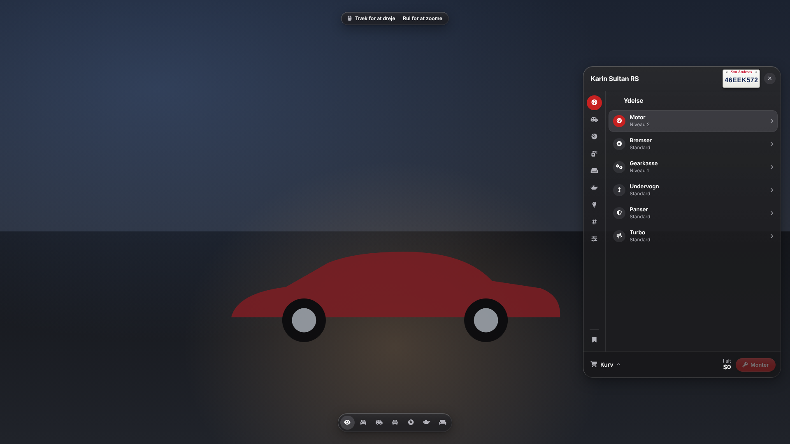 | 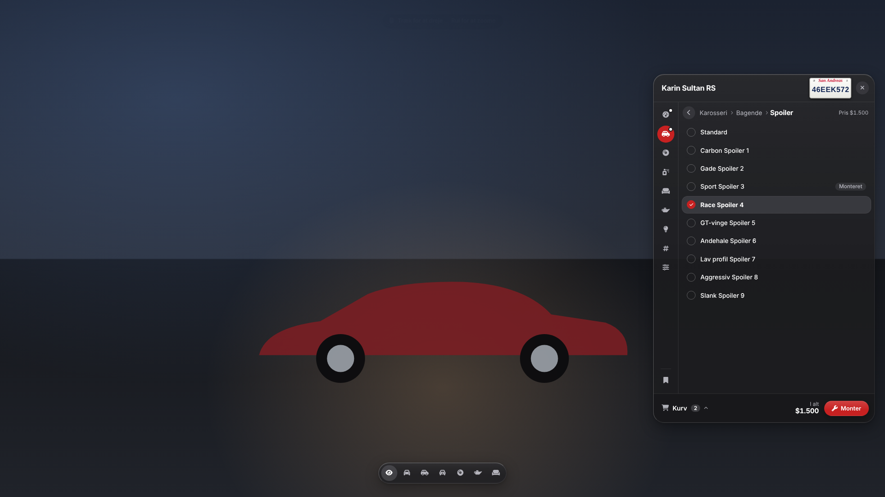 |
| **Lakering** | **Neon (klik på siderne)** |
| 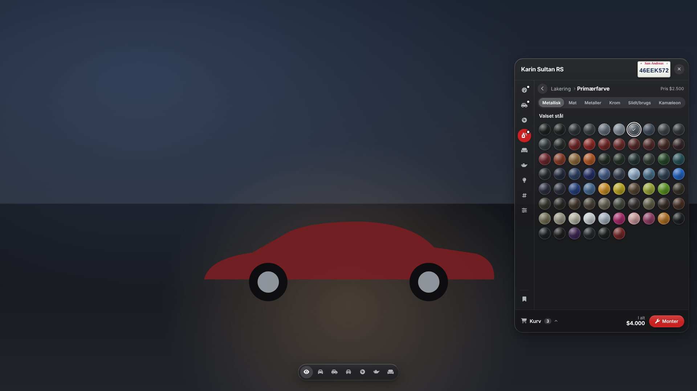 | 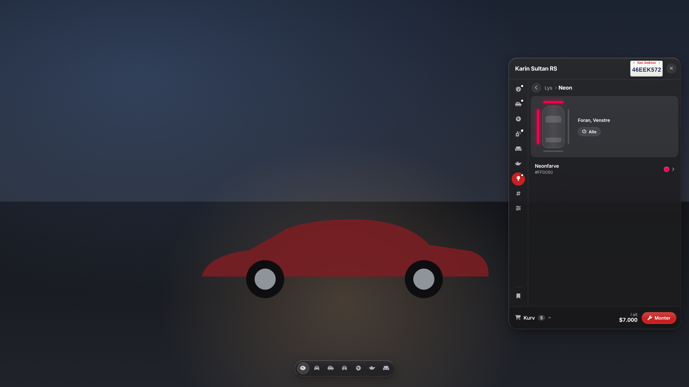 |
| **Presets** | **Kundeterminal (design-tilstand)** |
| 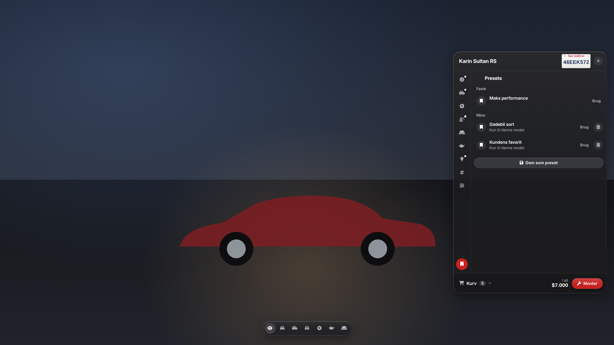 | 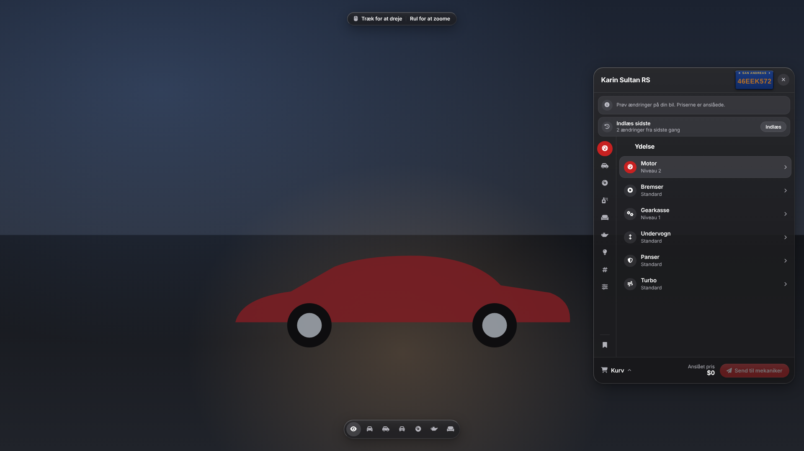 |

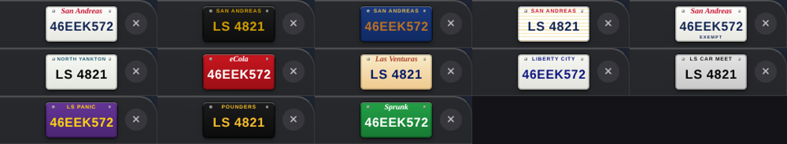

**Chefens computer**

| Skrivebord | Bestil |
|---|---|
| 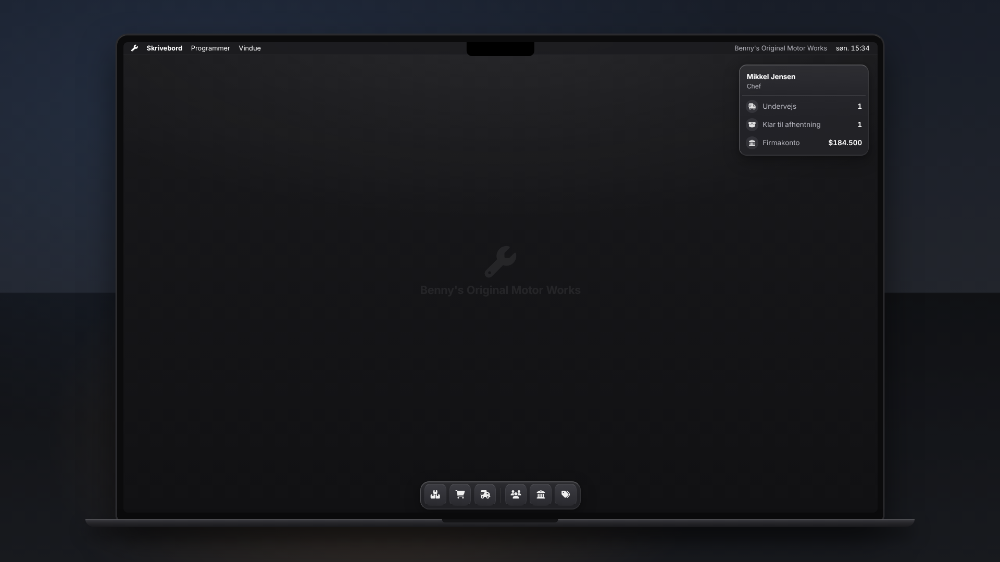 | 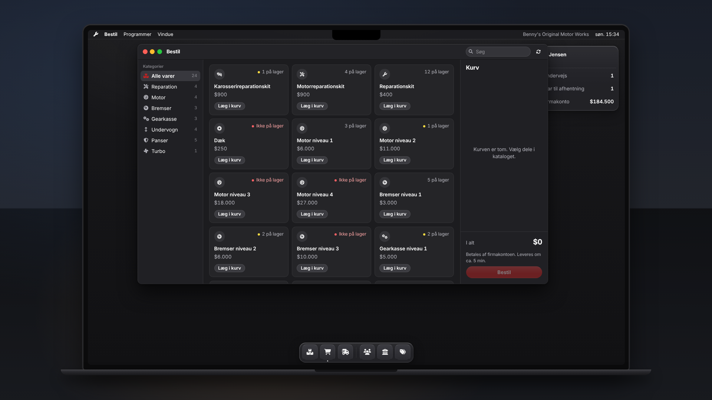 |
| **Personale** | **Økonomi** |
| 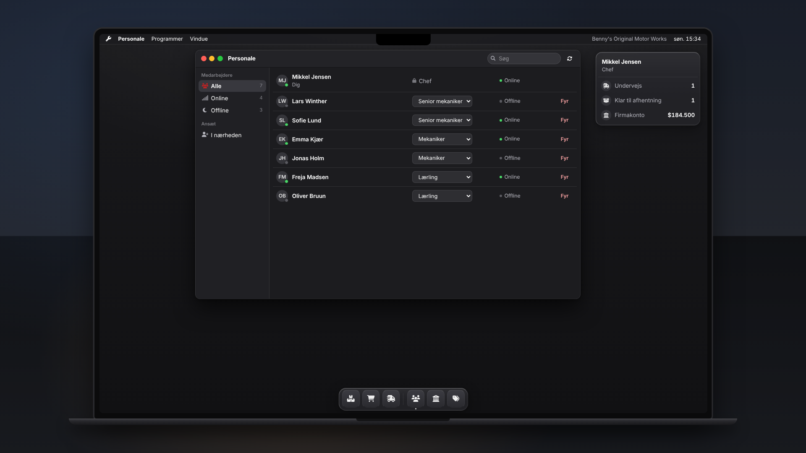 | 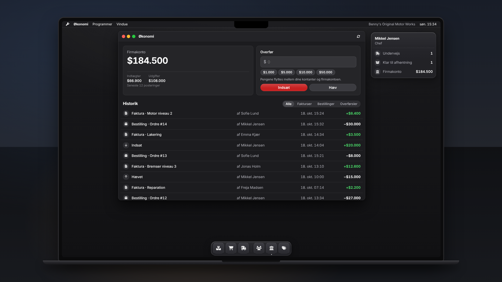 |
| **Prisliste** | |
| 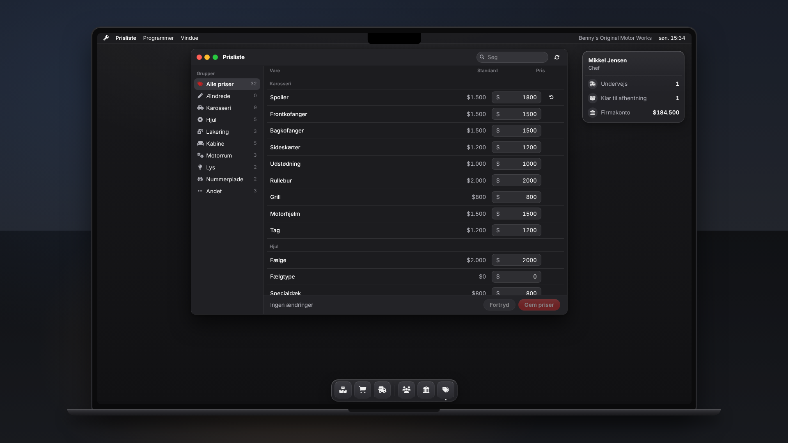 | |
